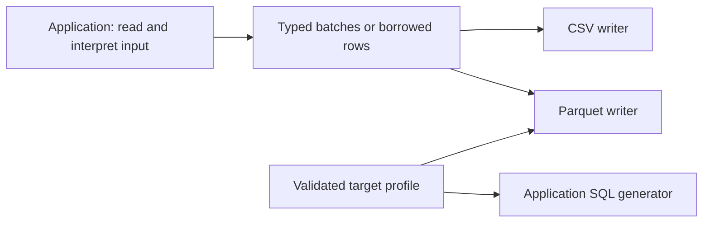
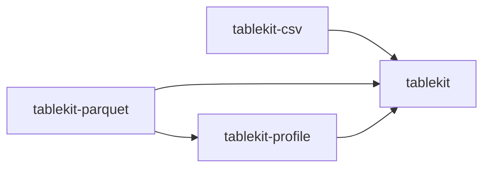

# Architecture

Tablekit separates application data from file encoding. Applications supply typed columns
or rows; the library writes a documented CSV or Parquet representation. The crate inventory
and extension boundaries are in [PROJECT-MAP.md](PROJECT-MAP.md).

## Why one table model

A shared table model lets batch exporters, streaming converters and reporting tools use the
same writers. CSV quoting, numeric formatting, null handling and Parquet type mappings are
specified once in [CSV-FORMAT.md](CSV-FORMAT.md) and [PARQUET.md](PARQUET.md).
Applications keep responsibility for parsing, decoding and interpreting their input.
Tablekit has no dependency on an application that uses it.

The SQL generator above is an integration point, not a SQL-generation service implemented
by tablekit. Profiles expose validated type mappings and comment templates for callers.

## Crates and boundaries

| Crate | Responsibility |
|---|---|
| `tablekit` | Named, typed columns; missing values; batches and schemas; compact text storage; `Source`, `BatchWriter`, serial `copy`; atomic file helper. No external dependencies. |
| `tablekit-csv` | Batch and streaming CSV, borrowed-row formatting, fixed-schema cell writers, quoting, numeric formats and line endings. |
| `tablekit-parquet` | Parquet schemas and column encoding, lossless profile-supported coercions, row groups and compression controls. Uses the Parquet column API without Arrow. |
| `tablekit-profile` | Validated TOML mappings, SQL comment templates and restricted record/partition declarations. See [PROFILES.md](PROFILES.md) for compatibility limits. |

There is no command-line application or Python package in this workspace. Applications can
expose their own bindings without changing the output contract.

## An export, end to end

1. The application interprets its input and constructs a `Batch` or implements `Source`.
2. The writer checks the table's schema and encodes its values.
3. A file helper writes beside the destination and renames only after success.

`tablekit::copy` drives a `Source` into a `BatchWriter` serially, one batch in memory at a
time. CSV and Parquet also expose `write_source` and `write_source_file` entry points.
A raw `Write` sink is a stream: it cannot undo bytes already written after an I/O error.
Use the file helpers when whole-file replacement is required.

## Rows or batches

`CsvWriter` consumes whole batches. `CsvFormat::row` writes borrowed `Value`s into a reused
buffer and checks each value's type in every build. Both follow the same CSV contract.
In a historical streaming-export benchmark, gathering batches before CSV formatting was
5–20% slower than formatting records as they arrived. That is workload-specific: measure
the application's data and buffering pattern. Parquet consumes columns in batches.

For fixed-schema caller code, `RowWriter` names each cell's type and format in its method.
Method/type/format agreement is checked in debug builds only; cell counts and quoting are
checked in every build. Release callers must use the right methods for their declared
schema. Use `CsvFormat::row` when the method sequence or schema is data-dependent.
Historical 46-column ARM application measurements reached 0.97 times the application's custom
writer time with identical bytes; this is evidence for that workload, not a general speed
promise. [CSV-070-VALIDATION.md](CSV-070-VALIDATION.md) records reproducible synthetic A/B
results, including a disclosed increase in row instructions despite neutral wall time.

`RowWriter` rolls back an unfinished row during drop or unwind. `UnguardedRowWriter` leaves
those cells in the buffer. It is appropriate only if incomplete output is discarded or the
caller explicitly restores the buffer. A historical two-CPU x86 application benchmark
measured guard overhead of 2.5% in decoding and 5% in merging; ARM results were within noise.
See [ROW-WRITER-GUARD.md](ROW-WRITER-GUARD.md) for the full safety boundary and evidence.
Quoted `text_with` cells expand backwards within the reusable output allocation, avoiding a
per-cell scratch allocation once capacity is warm.

## Format decisions

| Topic | Contract |
|---|---|
| CSV defaults | pandas `to_csv(index=False)` on Windows, with documented differences |
| Booleans | `True` / `False` in CSV; `BOOLEAN` in Parquet |
| Line endings | CRLF by default on every platform; LF is an option |
| Encoding | UTF-8 by default; `utf-8-sig` adds a byte-order mark |
| Missing values | Empty CSV cells by default, configurable through `na_rep`; Parquet nulls |
| Unsigned integers | Lossless widening for the bundled SQL target; full-range u64 as `DECIMAL(20,0)` |
| File replacement | Temporary file beside the target, renamed on successful completion |

Compression, dictionaries, data-page size and encoder-batch size are Parquet writer
options, separate from profile mappings. Tablekit does not create partition directories,
register tables in a database or interpret timestamps. See [PARQUET.md](PARQUET.md).

## Planned concurrency

The implemented driver remains single-threaded. A concurrent engine, tentatively called
`tablekit-run`, is a roadmap proposal, not an existing crate or API. Its proposed boundary
is jobs made from application sources and writers, without application-specific parsing.

Before implementation, profile reading, transformation, batch construction and writing.
Candidate requirements are bounded batches, bounded job count, cancellation between
batches, whole-file completion and byte-identical serial/parallel output. Account for
thread startup, scheduling and queue costs, especially for small tables. Applications with
shared input scans must design their own routing and ordering requirements rather than
assuming one independent scan per output is efficient. See [ROADMAP.md](../ROADMAP.md).
