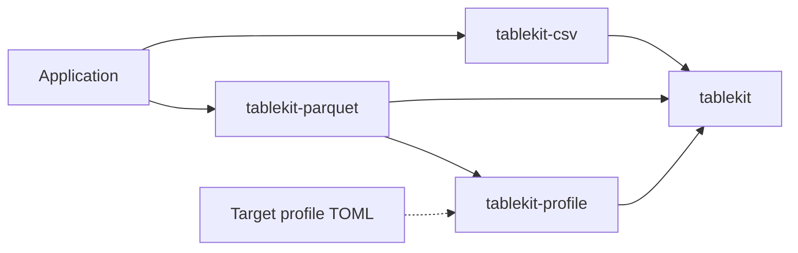

# Crate and integration map

Use this map to choose a crate and identify where a change belongs. Implemented items refer
to the current workspace; planned items are proposals with no delivery dates.

## Workspace

| Crate and source | Implemented | Put a change here when... |
|---|---|---|
| [tablekit](../crates/tablekit/src/lib.rs) | Typed columns, null masks, compact text buffers, batches and schemas; `Source`, `BatchWriter`, serial `copy` and atomic file helper | Extending a format-independent model or source/writer interface |
| [tablekit-csv](../crates/tablekit-csv/src/lib.rs) | Batch/stream CSV, borrowed rows, guarded and unguarded cell writers, cell formats, quoting, numeric text and encoding | Changing CSV output consistently for all callers |
| [tablekit-parquet](../crates/tablekit-parquet/src/lib.rs) | Explicit schemas, nulls, row groups, compression/dictionaries and lossless profile-supported coercions | Changing physical/logical Parquet encoding or writer buffering |
| [tablekit-profile](../crates/tablekit-profile/src/lib.rs) | Strict TOML validation, SQL/Parquet mappings, templates and constrained record/partition declarations | Extending supported target policy or validating a mapping |

The table model has no external dependencies. Format-specific dependencies stay in the
writer crates. The Parquet writer uses the column API, not the Arrow layer.

## Application responsibilities

Applications read and interpret their input, choose column names and types, resolve clocks,
and supply batches or rows. Tablekit encodes the resulting table. Directory layouts,
database registration, SQL statement generation and language bindings stay in applications.
A SQL generator can reuse `tablekit-profile` mappings and templates; tablekit does not
include a general SQL generator. The bundled profile has explicit compatibility restrictions,
not arbitrary database or partition-schema support: see [PROFILES.md](PROFILES.md).

There is no tablekit executable or Python package. Library examples and synthetic fixture
scripts are development tools, not extra application interfaces.

## Choosing a CSV interface

- Use `CsvWriter` or the file/source helpers for batches and streaming sources.
- Use `CsvFormat::row` for dynamic borrowed rows with type checks in every build.
- Use `RowWriter` for a fixed method sequence and automatic unfinished-row rollback.
- Use `UnguardedRowWriter` only when incomplete output is discarded or rolled back by the
  caller. Fast cell methods check type/format agreement in debug builds only.

See [CSV-FORMAT.md](CSV-FORMAT.md) and [ROW-WRITER-GUARD.md](ROW-WRITER-GUARD.md).

## Planned improvements and prerequisites

| Improvement | State | Prerequisite |
|---|---|---|
| Concurrent export engine (`tablekit-run`) | Planned; crate does not exist | Profile all stages; bound memory/cancellation; compare serial/parallel bytes and include startup costs |
| Coalesce small batches into Parquet row groups | Planned | Choose target rows/bytes and a memory bound |
| Fewer application-to-table copies | Planned, needs measurement | Define ownership transfer and measure allocations and retained memory |
| Additional CSV encodings | On request | Preserve the format contract and expected-file cases |
| Shared SQL/Parquet mappings and templates | Implemented in 0.5.0 | Extend validated profiles rather than duplicating type maps |
| Reusable template rendering | Implemented in profile 0.6.1 | Caller clears/reuses buffers and discards failed output |

[ROADMAP.md](../ROADMAP.md) contains the detailed rationale. Expected-file tests define the
output contracts; benchmark evidence belongs with the specific input and platform measured.
